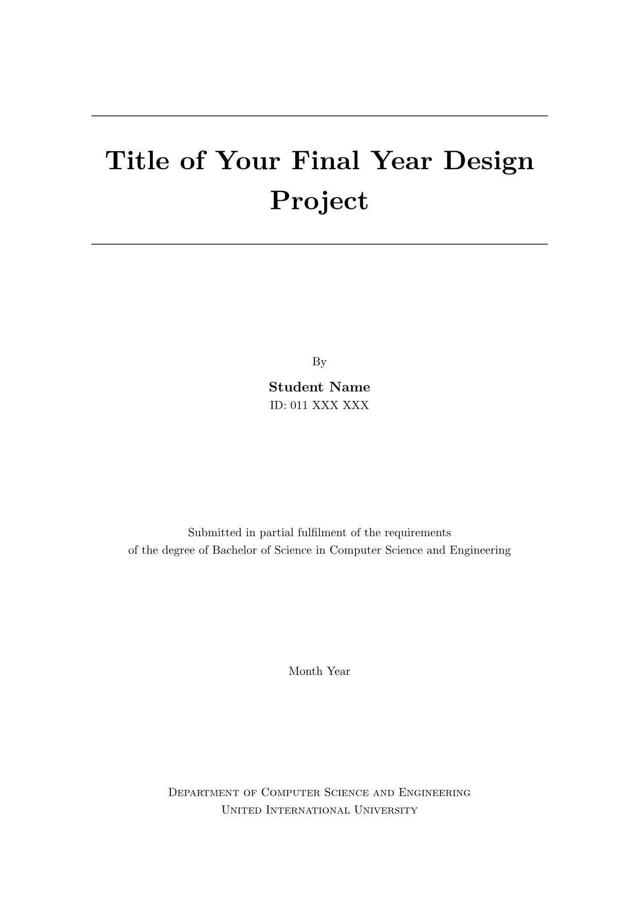

# UIU CSE FYDP Report · Typst

**Your project deserves more time than your formatting.**

Write your United International University CSE Final Year Design Project report
with a ready-to-use Typst template: a formatted cover, editable chapters,
automatic numbering, and references. Supports **FYDP-1 and final reports**.

**[Start your report on Typst Universe →](https://typst.app/universe/package/academic-uiu-fydp/)**

[Student guide](docs/STUDENTS.md) · [Moving from Overleaf?](docs/OVERLEAF-TO-TYPST.md) · [Report settings](docs/CONFIGURATION.md) · [Original LaTeX template](https://www.overleaf.com/latex/templates/united-international-university-fydp-template-department-of-cse/xbkpdgkgjdhc)

Published as **`academic-uiu-fydp` · v0.1.0**. Adapted by **Shaad Ahmmed** from
**Swakkhar Shatabda's** LaTeX template.

> This is a community adaptation, not an official university release. Confirm
> your supervisor's current formatting and submission requirements before use.



## Start in your browser — recommended

**No installation, terminal, Git, or LaTeX knowledge required.**

1. Open the [template on Typst Universe](https://typst.app/universe/package/academic-uiu-fydp/).
2. Click **Create project in app** and sign in or create a Typst account if prompted.
3. Open **`project.typ`** and replace the title, student names and IDs, submission
   date, and supervisor details. Uncomment the supervisor line to use it.
4. Write in **`chapters/`** and **`front-matter/`**. Replace the example diagram
   in **`assets/`** and add your sources to **`references.bib`**.
5. Review the live preview, then export your report as a **PDF** from the editor.

That is enough to start writing. **You do not need to clone this repository or
upload the template files manually.** Keep `main.typ` as the report's entry point;
you normally do not need to edit it.

**Already started on Overleaf?** Follow the
[Overleaf → Typst migration guide](docs/OVERLEAF-TO-TYPST.md) to reuse your text,
images, and bibliography one chapter at a time.

### Which files should I edit?

These paths are for projects created in the web app or with `typst init`:

| File or folder   | What to put there                                                                |
| ---------------- | -------------------------------------------------------------------------------- |
| `project.typ`    | Report title, team members, IDs, date, supervisors, and page options             |
| `front-matter/`  | Abstract, acknowledgements, and optional publications                            |
| `chapters/`      | Your introduction, background, design, implementation, standards, and conclusion |
| `assets/`        | Your diagrams and images                                                         |
| `references.bib` | Your bibliography; cite an entry with `@its-key`                                 |
| `content.typ`    | Report stage and chapter selection                                               |

**Writing FYDP-1?** In `content.typ`, change `default: "final"` to
`default: "fydp-1"`. This omits the implementation and results chapter and updates
chapter numbering automatically. Leave `"final"` for the final report, and check
required sections with your supervisor.

**Need a logo?** No university logo is included or required to compile. Add only
an approved image; the [student guide](docs/STUDENTS.md#front-matter-and-logo)
explains how.

## Why Typst? How does it compare with LaTeX?

Typst and LaTeX both turn text-based source files into formatted documents.
**Overleaf is an online editor for LaTeX**, not a separate typesetting language.

| Everyday task                        | Typst                                                              | LaTeX                                                                                           |
| ------------------------------------ | ------------------------------------------------------------------ | ----------------------------------------------------------------------------------------------- |
| See changes while writing            | Incremental compilation reuses previous work for fast previews     | Usually reruns the typesetting engine; larger projects can take longer                          |
| Build citations and cross-references | Built into the compiler; no separate BibTeX/Biber step             | Often needs multiple passes and a bibliography tool, usually automated by Overleaf or `latexmk` |
| Learn basic formatting               | Short syntax: `= Heading`, `*bold*`, `@citation`                   | Commands such as `\chapter{Heading}`, `\textbf{bold}`, `\cite{key}`                             |
| Work locally                         | One compiler, plus an editor of your choice                        | A TeX distribution and an editor/build setup                                                    |
| Reuse existing LaTeX material        | `.bib` libraries work; LaTeX commands and packages need conversion | Best fit for existing `.tex` projects and required LaTeX classes                                |

**Performance in practice:** Typst is designed for fast, incremental updates, so
small edits often appear almost immediately. Full PDF export still takes work;
report length, images, layout, hardware, and caching affect the result. This
repository does **not** include a controlled Typst-vs-LaTeX benchmark, so there is
no claimed speed multiplier. See [Typst's guide for LaTeX users](https://typst.app/docs/guides/for-latex-users/)
for the underlying differences.

LaTeX still has a larger, mature package ecosystem. If your supervisor requires
LaTeX source or a specific LaTeX class, use the
[original Overleaf template](https://www.overleaf.com/latex/templates/united-international-university-fydp-template-department-of-cse/xbkpdgkgjdhc)
instead. This adaptation follows its structure; it does not promise identical
line breaks or pagination.

### Overleaf Free: limitations to know before starting

Overleaf is convenient, but its free plan can matter for a team report:

| Limitation                                      | What it means for your FYDP                                                                                                            |
| ----------------------------------------------- | -------------------------------------------------------------------------------------------------------------------------------------- |
| **1 invited collaborator per project**          | The owner can invite one editor/reviewer; a larger team plus a supervisor may need a paid or institutional plan.                       |
| **Basic compile timeout**                       | Long or graphics-heavy reports can hit the time limit. Optimizing the project or using a plan with more compile time may be necessary. |
| **Only the previous 24 hours of history**       | Do not rely on the free history as your only backup.                                                                                   |
| **No track changes or Git integration on Free** | These review/version-control features require a paid or institutional plan.                                                            |

These are **Overleaf service limits, not LaTeX limits**. Local LaTeX has no
Overleaf-imposed compile timeout or subscription requirement.

Typst's web app also has plan limits: Free currently lists **200 MB storage and
100 files per project**, while features such as comments and Git sync are paid.
The **local Typst compiler is free and open source** and is not subject to web-app
plan limits. Check [Overleaf's plans](https://www.overleaf.com/user/subscription/plans)
and [Typst's plans](https://typst.app/pricing/) before choosing; features can change
(checked November 2026).

## Prefer working on your computer?

Install [Typst 0.15.0 or newer](https://github.com/typst/typst#installation).
For example, use `winget install --id Typst.Typst` on Windows or
`brew install typst` on macOS. Linux binaries are available from the
[official releases](https://github.com/typst/typst/releases/latest).

Then run:

```sh
typst init @preview/academic-uiu-fydp:0.1.0 my-fydp
cd my-fydp
typst compile main.typ report.pdf
```

Open **`report.pdf`** to see the result. For automatic rebuilds while editing:

```sh
typst watch main.typ report.pdf
```

The first initialization downloads the package, so an internet connection is
needed. Once the package is cached, this starter can compile offline. You do
**not** need Python, Make, or a LaTeX installation. For an editor preview, VS Code
users can install **Tinymist** and open the generated project folder.

## What is already included?

- **Report structure:** cover, abstract, acknowledgements, optional publications,
  and six editable chapter files with guidance.
- **Automatic formatting:** contents, figure/table lists, chapter headers,
  Roman front-matter pages, and Arabic body pages.
- **Academic essentials:** figures, tables, equations, engineering mapping
  tables, and an IEEE numeric bibliography using your `.bib` file.
- **Layout defaults:** A4 paper, 3 cm margins, and 11 pt New Computer Modern.

### Before you submit

- [ ] Replace all sample names, IDs, text, diagrams, and table placeholders.
- [ ] Check that your report stage and sections match your supervisor's instructions.
- [ ] Verify your citations and bibliography, and support mapping claims with evidence.
- [ ] Read the exported PDF: cover, contents, numbering, captions, and page breaks.
- [ ] Keep a backup of your editable sources and assets, not just the PDF.

## Need more help?

| I want to…                                             | Read this                                                                              |
| ------------------------------------------------------ | -------------------------------------------------------------------------------------- |
| Learn headings, figures, citations, and report writing | [Student guide](docs/STUDENTS.md) · [Typst tutorial](https://typst.app/docs/tutorial/) |
| Change report settings or add optional pages           | [Configuration reference](docs/CONFIGURATION.md)                                       |
| Prepare a reviewed copy for a class                    | [Educator guide](docs/EDUCATORS.md)                                                    |
| Move an existing Overleaf report to Typst              | [Step-by-step migration guide](docs/OVERLEAF-TO-TYPST.md)                              |
| Understand differences from the LaTeX original         | [Original conversion notes](docs/MIGRATION.md)                                         |
| Report a template problem                              | [GitHub issues](https://github.com/shaadahmmed/uiu-fydp-template/issues)               |

<details>
<summary><strong>For maintainers: build this repository</strong></summary>

Students using the published template can skip this section. In a repository
checkout, editable student files live under **`template/`** rather than at the
project root. Compile **root `main.typ`** to use the local `lib.typ`.

With Typst 0.15.0+ and Python 3.11+ installed, run from the repository root:

```sh
python3 scripts/project.py doctor
python3 scripts/project.py build
python3 scripts/project.py build --stage fydp-1
python3 scripts/project.py check
```

On Windows, use `py -3` instead of `python3` if needed. Reports are written to
`build/fydp.pdf` and `build/fydp-1.pdf`. GNU Make is optional. These helpers use
bundled fonts and do not download Typst packages.

See the [publishing guide](docs/PUBLISHING.md) for packaging and release commands,
[package README](packaging/README.md) for the distributed API documentation, and
[changelog](CHANGELOG.md) for version history. Changes here do not automatically
update the published Universe package or existing student projects.

</details>

## Credits and license

Adapted by **Shaad Ahmmed** from the
[UIU CSE FYDP LaTeX template](https://www.overleaf.com/latex/templates/united-international-university-fydp-template-department-of-cse/xbkpdgkgjdhc)
by **Swakkhar Shatabda**. Both the original template and this adaptation use
**[CC BY 4.0](https://creativecommons.org/licenses/by/4.0/)**.
See [LICENSE](LICENSE) and [NOTICE](NOTICE).

When sharing adapted template material, retain attribution, link the license,
and identify your changes. This does not automatically license your original
research, prose, results, or data. No university logo is distributed; university
names and trademarks are not licensed by this project.
